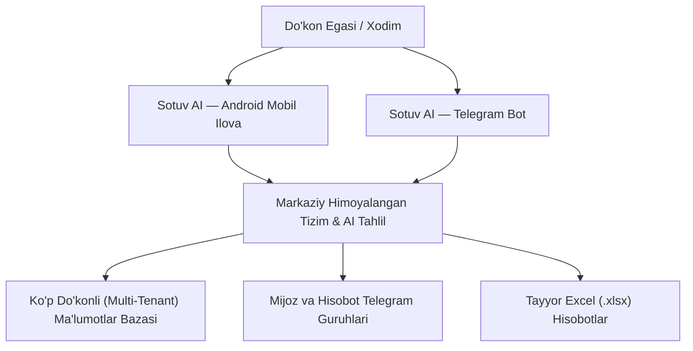

# 📊 Sotuv AI — Aqlli Savdo, Qarz va Kassa Tizimi

[](#)
[](#)
[](#)
[](#)
[](#)

**Sotuv AI** — do'konlar, uyda ishlab chiqaruvchilar va ulgurji savdo nuqtalari uchun yaratilgan zamonaviy **SaaS savdo, qarz daftari, kassa nazorati va AI hisobot platformasi**.

Tizim **Android mobil ilova** hamda **ixcham Telegram bot**ni yagona bulutli ma'lumotlar bazasi atrofida birlashtiradi. Har bir do'kon o'z mahsulotlari, mijozlari, narxlari, kassasi va hisobotlarini boshqalardan to'liq ajratilgan muhitda boshqaradi.

---

## 🧭 Tizim Umumiy Ko'rinishi



---

## 📱 Mobil Ilova — Qayerda Nima Bor?

Ilova pastki suzuvchi panelda **4 ta asosiy bo'lim** va markazda **✨ AI Sotuv** tugmasidan iborat. Sahifalar o'rtasida tugma orqali ham, **chapga-o'ngga surish (swipe)** orqali ham bemalol o'tish mumkin.

### 1. 🔐 Kirish va Qurilma Himoyasi
- **Telegram orqali 1-bosishda kirish:** Ilovadan Telegramga o'tib `START` bosilgach, hisob avtomatik ulanadi va ilovaga qaytish tugmasi chiqadi.
- **6 xonali kod bilan kirish:** Telegram botdan olingan bir martalik kod orqali ID kiritmasdan tez ulanish.
- **2 bosqichli 4 xonali PIN-kod:** Ilovaga birinchi kirishda PIN yaratish va tasdiqlash so'raladi; keyingi kirishlarda bitta kiritish yetarli.
- **Barmoq izi (Otpechatka):** Qurilma qo'llab-quvvatlasa, barmoq izi bilan bir lahzada ochish mumkin. Ilova yangilanganda ham PIN va barmoq izi saqlanib qoladi.

### 2. 🏠 Asosiy (Dashboard)
- **Davr tanlash:** `Bugun`, `7 kun`, `Shu oy`, `O'tgan oy`, `30 kun` kesimida tezkor tahlil.
- **Tezkor amallar paneli:** Asosiy ekrandanoq 1-bosishda **Sotuv**, **Pul oldim**, **Xarajat** va **Kun yopish** oynalarini ochish.
- **Daromad taqsimoti va Foyda marjasi:** Savdo tushumi, sof foyda, tannarx/vozvrat hamda foyda dinamikasi grafiklari.
- **KPI kartalar:** Kassa qoldig'i, Mijozlar qarzi, Naqd/Karta yig'imi va Xarajatlar (raqamlar jonli animatsiya bilan to'ladi).
- **Analitika grafiklari:** Pul oqimi ustunli grafigi (`7k / 30k / 60k / 90k`), xarajatlar taqsimoti va **Top mijozlar** reytingi.
- **Excel Hisobotlar:** `Davriy`, `Bugungi` va `Tarix` hisobotlarini telefonda ochish yoki messenjerga ulashish.
- **Mavzu va Yangilash:** Yuqori paneldan 1-bosishda **Oq / Qora** mavzuga o'tish (tanlov saqlanib qoladi) va aylanuvchi yangilash tugmasi.

### 3. ✨ Markaziy AI Sotuv Tugmasi
Pastki panel o'rtasidagi yorqin **AI** tugmasi orqali 3 xil usulda sotuv kiritiladi:
1. **AI Chek (Rasm):** Kamera yoki galereyadan nakladnoy / tarozi chekini yuklab, mahsulot va miqdorlarni avtomatik o'qitish.
2. **Tezkor Matn:** Ovozdan matnga aylantirib yoki qisqa yozib (masalan: `Anvar 15 kg`) darhol sotuv yaratish.
3. **Qo'lda kiritish:** Bir nechta mahsulot qatori, birlik (`kg`, `dona`, `porsiya`, `litr`), maxsus narx va jonli yakuniy hisob-kitob.
- **Sotuvni ko'rish va boshqarish:** Mijozni almashtirish, qatorlarni tahrirlash, tasdiqlash, **Pulini oldim** tezkor to'lovi, **Chekni ulashish** va Telegram guruhga yuborish / o'chirish.

### 4. 👥 Mijozlar va Akt Sverka
- **Qidiruv, Saralash va Filtrlar:** Ism/telefon bo'yicha qidiruv, `Qarz bo'yicha` / `A–Z` saralash hamda `Hammasi`, `Qarzdorlar`, `Avans`, `Guruhli` filtrlari.
- **Kartochkadan tezkor pul olish:** Qarzdor mijoz yonidagi to'lov tugmasidan darhol pul qabul qilish (`To'liq qarz`, `50%`, `+100k`, `+500k` tezkor tugmalari bilan).
- **Mijoz ichki sahifasi:**
  - Joriy qarz / avans ko'rsatkichi va telefon raqamiga bosib **1-bosishda qo'ng'iroq qilish**;
  - **Pul oldim**, **Vozvrat**, **Shaxsiy narxlar** (har bir mijozga alohida narx), **Excel Sverka**, **Ulashish** (tayyor matnli sverka) va **Telegram guruhga Sverka**;
  - **Akt Sverka** (xronologik balans jadvali) va **Operatsiyalar** (sotuv/to'lovni tahrirlash yoki o'chirish).

### 5. 💰 Kassa va Smenalar Tarixi
- **Jonli Kassa Balansi:** Kun boshi, naqd tushum, kirim, xarajatlar va kassa qarzi bo'yicha real vaqt hisobi.
- **Tartibli 6 ta kassa amali:** `Pul oldim`, `Xarajat` (kategoriyalar bilan), `Kirim`, `Kassa qarz`, `Qaytarish` va `Kunni yopish` (jonli **Sverka farqi** bilan).
- **Bugungi ro'yxatlar:** `Sotuvlar`, `To'lovlar`, `Vozvrat`, `Xarajat/Kassa` bo'limlari — istalgan to'lov yoki kassa yozuvi ustiga bosib tahrirlash mumkin.
- **Smenalar Tarixi:** Yopilgan kunlar ro'yxati; istalgan kunni bosib o'sha kunning savdo, foyda, xarajat va to'lovlar tafsilotini ko'rish, qayta ochish yoki Excel yuklash.

### 6. ⚙️ Sozlamalar
- **Do'kon va Obuna kartasi:** Do'kon nomi, tarif holati, qolgan kunlar va kunlik AI foydalanish ko'rsatkichi.
- **Avtomatizatsiya:** `Avto-tasdiq`, `Guruh avto-hisob` va summani yaxlitlash (`Yo'q`, `1000`, `Pastga`).
- **Mahsulotlar katalogi:** Mahsulot qo'shish, tannarx/sotuv narxi va birligini tahrirlash yoki o'chirish.
- **Ilova va Xavfsizlik:** `Tizim / Oq / Qora` mavzu, `Barmoq izi` va `PIN-kod` sozlamalari, ilova ichidan **Yangilash** tekshiruvi, faol **Qurilmalar** ro'yxati va hisobdan chiqish.

### 7. 👑 Super Admin Paneli *(faqat tizim egasiga ko'rinadi)*
- **Statistika:** Oylik MRR, pullik/faol/tugagan/bloklangan do'konlar soni, 30 kunlik va jami tushum, AI foydalanish statistikasi.
- **Do'konlar boshqaruvi:** 1 qadamda yangi do'kon + egasini yaratish, `+7 / +30 / +90 kun` obuna uzaytirish, tarif va AI limitini tahrirlash, muzlatish/faollashtirish, xodim qo'shish, 1-bosishda rol almashtirish (`owner ↔ staff`) va ruxsatni uzish.
- **Tarix va E'lonlar:** Barcha foydalanuvchilarga e'lon yuborish va muhim amallar audit jurnali.

---

## 🤖 Telegram Bot Bo'limlari

Bot foydalanuvchi uchun ortiqcha menyularsiz **4 ta asosiy bo'lim**da ishlaydi:

| Bo'lim | Vazifasi |
|---|---|
| **📲 APK** | Android ilovaning eng so'nggi versiyasini yuklab olish va 6 xonali kirish kodini olish |
| **📊 Dashboardlar** | Kunlik va davriy (7/30 kun, shu/o'tgan oy) hisobotlar hamda `.xlsx` Excel fayllar |
| **👥 Guruh sozlash** | Rahbariyat hisobot guruhi va mijoz guruhlarini 1-bosishda bog'lash |
| **🛡 Status** | Do'kon nomi, obuna muddati va AI limit holatini tekshirish |

> Mijoz Telegram guruhiga yuborilgan nakladnoy yoki tarozi rasmlari avtomatik hisoblanadi va guruhga faqat mijoz uchun kerakli ma'lumotlar chiqariladi.

---

## 📁 Loyiha Papkalari Xaritasi

Har bir papkaning aniq vazifasi:

```text
Sotuv AI/
├── Sotuv_readme.md                # Loyiha to'liq hujjati (ushbu fayl)
├── main.py                        # Telegram bot ishga tushirish nuqtasi
├── config.py                      # Tizim sozlamalari modeli
├── requirements.txt               # Python kutubxonalari ro'yxati
│
├── mobile_app/                    # Android mobil ilova (Flutter / Material 3)
│   └── lib/
│       ├── main.dart              # Ilova kirish nuqtasi, tema, PIN/biometrik oqim
│       ├── core/
│       │   ├── security/          # Barmoq izi, 4 xonali PIN yaratish va qulf ekrani
│       │   ├── state/             # Holat boshqaruvi (sessiya, mavzu, ma'lumot yangilanishi)
│       │   ├── theme/             # Oq va Qora mavzu palitrasi hamda tugma stillari
│       │   ├── update/            # Ilova ichidan yangi versiyani tekshirish va o'rnatish
│       │   ├── utils/             # Summa, vazn, sana va to'lov usuli formatlovchilari
│       │   └── widgets/           # Kartalar, grafiklar, shimmer, animatsiya, ActionGuard
│       └── features/
│           ├── auth/              # Kirish ekrani (1-bosish Telegram + 6 xonali kod)
│           ├── shell/             # Pastki suzuvchi menyu, swipe navigatsiya, Back himoyasi
│           ├── dashboard/         # Asosiy ekran, KPI, grafiklar, Tezkor amallar, Excel
│           ├── sales/             # AI Chek, Tezkor Matn, Qo'lda sotuv va Chek ko'rish
│           ├── clients/           # Mijozlar ro'yxati, qidiruv, kartochka va Akt Sverka
│           ├── cash/              # Kassa, to'lov/xarajat oynalari, tahrirlash va kun tarixi
│           ├── settings/          # Do'kon sozlamalari, mahsulotlar, xavfsizlik, qurilmalar
│           └── admin/             # Super Admin SaaS boshqaruv paneli
│
├── bot/                           # Telegram bot mantiqi
│   ├── keyboards.py               # 4 bo'limli menyu va inline tugmalar
│   ├── middlewares.py             # Obuna va foydalanuvchi ruxsat tekshiruvi
│   ├── states.py                  # Muloqot bosqichlari (FSM)
│   ├── ui_helpers.py              # Telegram xabarlari va jadvallar formati
│   └── handlers/
│       ├── apk_link.py            # APK yuklash va tezkor kirish tasdiqlashi
│       ├── clients_products.py    # Mijozlar, mahsulotlar va guruh bog'lash
│       ├── sales_norin.py         # Sotuvlar, guruh avto-hisobi va to'lovlar
│       ├── wallet_reports.py      # Kassa, davriy hisobotlar va Excel eksport
│       └── superadmin.py          # Bot ichidagi Super Admin boshqaruvi
│
├── services/                      # Biznes xizmatlar
│   ├── gemini_ai.py               # Rasm va ovoz AI tahlili + mahalliy matn parseri
│   ├── group_notify.py            # Mijoz guruhlariga xavfsiz xabar yuborish
│   └── excel_export.py            # Kunlik, davriy, tarix va Akt Sverka Excel generatori
│
├── database/                      # Ma'lumotlar bazasi qatlami
│   ├── models.py                  # Do'kon, foydalanuvchi, mijoz, mahsulot, sotuv, kassa jadvallari
│   ├── session.py                 # Ulanish, jadval migratsiyasi va boshlang'ich tayyorlash
│   ├── fsm_storage.py             # Doimiy bot holatlari saqlovchisi
│   └── crud.py                    # Do'kon kesimidagi barcha hisob-kitob va yozuv amallari
│
└── tests/                         # Avtomatik tekshiruv testlari
    ├── test_all.py                # Biznes mantiq, qarz/kassa, Excel va izolyatsiya testlari
    └── test_api.py                # Xavfsizlik, obuna nazorati va ko'p do'konli testlar
```

---

## 🛡 Xavfsizlik va Ishonchlilik Tamoyillari

Tizim real biznes va moliyaviy hisob-kitoblar uchun quyidagi himoya qatlamlari bilan qurilgan:

1. **To'liq Multi-Tenant Izolyatsiya:** Har bir do'konning mijozlari, sotuvlari, narxlari va kassasi qat'iy ajratilgan — bir do'kon boshqa do'kon ma'lumotlariga kira olmaydi.
2. **Mijoz Guruhlarida Tijoriy Sir Himoyasi:** Mijoz bilan umumiy Telegram guruhlariga yuboriladigan chek va sverkalarda **tannarx** va **sof foyda** hech qachon ko'rsatilmaydi.
3. **Qurilma va Sessiya Himoyasi:**
   - Kirish tokenlari telefonda **shifrlangan xotirada** saqlanadi;
   - **Barmoq izi + 4 xonali PIN-kod** ruxsatsiz ko'rishdan himoyalaydi;
   - Faol qurilmalarni `Sozlamalar → Qurilmalar` orqali ko'rish va masofadan uzish mumkin;
   - Super Admin biror xodimning ruxsatini bekor qilsa, uning faol sessiyasi shu zahoti to'xtatiladi.
4. **Jonli Obuna Nazorati:** Obuna muddati tugagan yoki muzlatilgan do'konlarda yangi amallar avtomatik to'xtatiladi, biroq mijoz o'z holatini ko'rishi va **Excel hisobotlarini** yuklab olishi saqlanib qoladi.
5. **3 Qatlamli 2–3 Marta Bosilishdan Himoya:**
   - Tugma va oynalar (`ActionGuard`) bosilganda qayta bosishni bloklaydi;
   - Tasdiqlash va saqlash oynalari faqat 1 marta ishlaydi;
   - Tarmoq darajasida bir xil yozuvning qisqa vaqt ichida dublikat yuborilishi avtomatik to'xtatiladi (ikki marta to'lov yoki xarajat tushib qolmaydi).
6. **Xato Harakatlardan Himoya:**
   - O'chirish, tozalash va chiqish amallari tasdiqlash oynasi orqali bajariladi;
   - Probel yoki vergul bilan kiritilgan summalar (`1 500 000`, `12,5`) xatosiz o'qiladi;
   - Android «Orqaga» tugmasi bosilganda ilova tasodifan yopilib ketmaydi;
   - Maxfiy sozlamalar, kalitlar va zaxira fayllari versiya nazoratidan (`.gitignore`) tashqarida saqlanadi.

---

## 👤 Rollar va Huquqlar

| Imkoniyat | Super Admin | Do'kon Egasi (`owner`) | Xodim (`staff`) |
|---|:---:|:---:|:---:|
| Sotuv, to'lov, vozvrat va kassa yuritish | ✅ | ✅ | ✅ |
| Mijozlar, shaxsiy narxlar va Excel eksport | ✅ | ✅ | ✅ |
| Do'kon sozlamalari va mahsulotlar katalogi | ✅ | ✅ | ✅ |
| Boshqa do'konlarni ko'rish va boshqarish | ✅ | ❌ | ❌ |
| Obuna uzaytirish, muzlatish, xodim ulash | ✅ | ❌ | ❌ |
| Global MRR analitika va barchaga e'lon | ✅ | ❌ | ❌ |

---

## ✅ Sifat va Test Qamrovi

Har bir yangi versiya chiqarilishidan oldin quyidagi avtomatik tekshiruvlardan o'tadi:
- **Backend & Biznes Mantiq (`30` ta test):** Savdo, qarz, avans, vozvrat, kassa sverka, Excel eksport, ko'p do'konli izolyatsiya, obuna bloki va sessiya bekor qilish tekshiruvlari.
- **Mobil Ilova (`12` ta test):** Oq/Qora mavzu, o'zbekcha formatlovchilar, kirish ekrani, PIN 2 bosqichli tasdiqlash, animatsiyalar, swipe navigatsiya, pastki menyu moslashuvi va 2–3 marta bosilishdan himoya (`ActionGuard`) testlari.
